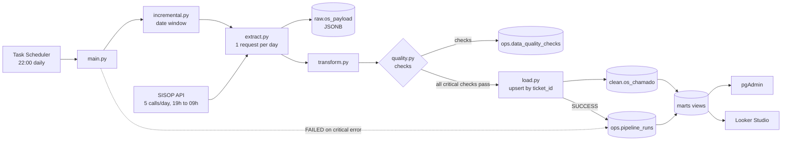

# OS Pipeline: SISOP API to PostgreSQL

A daily data pipeline that extracts service orders (OS) for school network support from a REST API, validates them, loads them into PostgreSQL, and exposes them to a Looker Studio dashboard. Every execution is recorded, and a critical data quality failure stops the load before anything reaches the clean layer.

## Architecture



**Layers**

- **Ingestion:** `main.py` decides the date window through `incremental.py`. `extract.py` makes the only API call of the run and stores the raw response in `raw.os_payload`.
- **Processing:** `transform.py` types and normalizes the records. `quality.py` runs the checks and stores the results. `load.py` writes the valid records to `clean.os_chamado` in a single transaction.
- **Storage:** `raw` keeps the API responses for replay. `clean` holds one row per ticket. `ops` holds one row per execution and one row per check.
- **Consumption:** `marts` views expose only the columns the dashboard needs. Looker Studio and pgAdmin read from them.

## Stack

Python 3.12+, pandas, requests, psycopg 3, python-dotenv, pytest, PostgreSQL 18 (Render), Looker Studio, Windows Task Scheduler.

## Design decisions

- **Quota-aware extraction.** The API allows 5 calls per day. Each run makes exactly one request and does not retry automatically, because a retry would consume quota that the next run may need.
- **Incremental window.** Each run starts one day before the last successful load. The one-day overlap protects against updates that arrive late. The first run starts from a fixed date.
- **Idempotent loads.** Records are written with `INSERT ... ON CONFLICT (ticket_id) DO UPDATE`. Running the same window twice updates rows instead of duplicating them.
- **Raw layer for replay.** The original response is stored as JSONB before any transformation, so the data can be reprocessed without calling the API again.
- **Critical checks stop the load.** A CRITICAL failure aborts the run before `clean` is touched. A WARNING is logged and the load continues.
- **Every run is recorded.** Successful and failed runs both get a row in `ops.pipeline_runs`, with the error message when there is one.
- **Read-only access for the dashboard.** Looker Studio connects with a role that can only read the `marts` views. It never uses the database owner.
- **No credentials in the repository.** Configuration comes from a `.env` file that Git ignores.

## Data model

**`raw.os_payload`**: one row per record received from the API, with `run_id`, `loaded_at` and the original `payload`.

**`clean.os_chamado`**: one row per ticket, keyed by `ticket_id` (the API field `Protocolo`). Includes school, status, creation and closing dates, days open, and the last note. Constraint: the closing date cannot be earlier than the creation date.

**`ops.pipeline_runs`**: one row per execution, with `status` (`RUNNING`, `SUCCESS`, `FAILED`), row counts and the error message.

**`ops.data_quality_checks`**: one row per check per execution, with severity, pass or fail, and the number of failing rows.

**`marts.os_chamados`** and **`marts.execucoes`**: read-only views over the tables above. The first excludes the free-text note field.

## Data quality checks

| Check | Severity | Rule |
|---|---|---|
| `campos_obrigatorios_preenchidos` | CRITICAL | Ticket ID, school and status are filled, and the creation date is valid |
| `finalizacao_antes_da_criacao` | CRITICAL | The closing date is not earlier than the creation date |
| `data_criacao_no_futuro` | CRITICAL | The creation date is at most one day in the future |
| `taxa_de_descarte` | WARNING | At most 5% of the records are discarded by the transformation |
| `status_dentro_do_dominio` | WARNING | Every status is in the list of known values |
| `registros_extraidos` | WARNING | The API returned at least one record |

The list of known statuses lives in `STATUS_ESPERADOS` in `src/quality.py`. A new status from the API raises a WARNING until it is added to that list.

## Project structure

```
os_pipeline/
├── src/
│   ├── main.py            # orchestration and run tracking
│   ├── incremental.py     # date window calculation
│   ├── extract.py         # API request and response parsing
│   ├── transform.py       # typing, normalization, deduplication
│   ├── quality.py         # checks and severity rules
│   ├── load.py            # run tracking, raw and clean writes
│   └── db.py              # database connection from .env
├── sql/
│   ├── 01_schema.sql      # schemas and tables
│   └── 02_marts.sql       # views for the dashboard
├── tests/
│   ├── test_transform.py
│   ├── test_quality.py
│   └── test_incremental.py
├── docs/
│   └── dashboard.png
├── run_daily.ps1          # script used by the scheduler
├── requirements.txt
├── pytest.ini
├── .env.example
└── README.md
```

## Setup

**Prerequisites:** Python 3.12 or 3.13, a PostgreSQL 18 database (for example, on Render), and an API key for the SISOP service.

```powershell
git clone (https://github.com/maycon-castro-git/os_pipeline.git)
cd os_pipeline
python -m venv .venv
.venv\Scripts\activate
pip install -r requirements.txt
```

Copy `.env.example` to `.env` and fill in the values:

```
DB_HOST=your-host.region-postgres.render.com
DB_PORT=5432
DB_NAME=os_pipeline
DB_USER=os_pipeline_user
DB_PASSWORD=your-password
SISOP_API_URL=your-api-url
SISOP_API_KEY=your-api-key
```

Create the schema by running `sql/01_schema.sql` in the database. Then create the dashboard views by running `sql/02_marts.sql`.

Run the unit tests. They do not use the API or the database:

```powershell
python -m pytest -v
```

## Running the pipeline

Incremental run, the default. The window is calculated from the last successful load:

```powershell
python src/main.py
```

Manual run for a fixed period, for example to recover missing data:

```powershell
python src/main.py --inicio 01/01/2026 --fim 10/24/2026
```

Each run uses one API request, so repeated test runs consume the daily quota. The API responds only between 19:00 and 09:00.

## Scheduling

The pipeline runs daily through Windows Task Scheduler. The task calls `run_daily.ps1`, which runs `src/main.py` without arguments, so the incremental window is used.

1. Open Task Scheduler and create a task named `OS Pipeline Diário`.
2. Trigger: daily at 22:00.
3. Action: `powershell.exe` with the arguments `-NoProfile -ExecutionPolicy Bypass -File "<project-path>\run_daily.ps1"`, starting in the project folder.
4. Enable *Run the task as soon as possible if a scheduled start is missed*.

The machine must be on at the scheduled time.

## Dashboard

The Looker Studio dashboard reads the `marts` views through a read-only role.

1. In Looker Studio, create a data source with the PostgreSQL connector.
2. Use the database host, port `5432`, database `os_pipeline`, the read-only user, and SSL required.
3. Build the pages below from the views.

Pages:

1. **Overview:** total tickets, open versus closed, average days open.
2. **Schools:** tickets per school, ranked, with open counts.
3. **Trend:** monthly tickets created and closed.
4. **Pipeline health:** success rate of recent runs, rows loaded per run, failed runs.


## Limitations

- The API limits access to 5 calls per day and responds only between 19:00 and 09:00.
- Some fields in the reference model are not provided by the API: city, priority, causes and assignee. They are left empty.
- Region and state are constants in `transform.py`, because the project covers a single region.
- The status list is maintained by hand. A new status triggers a WARNING until it is added.
- Scheduling depends on a Windows machine that must be on at the scheduled time.
- The Render free database expires after 30 days, so a production setup needs a paid plan.

## Next steps

- Use the last successful load date to set the window, instead of a fixed start date.
- Move scheduling to a cloud runner, so it does not depend on a local machine.
- Send an alert when a run finishes with `FAILED`.
- Add retention rules for the `raw` layer.
